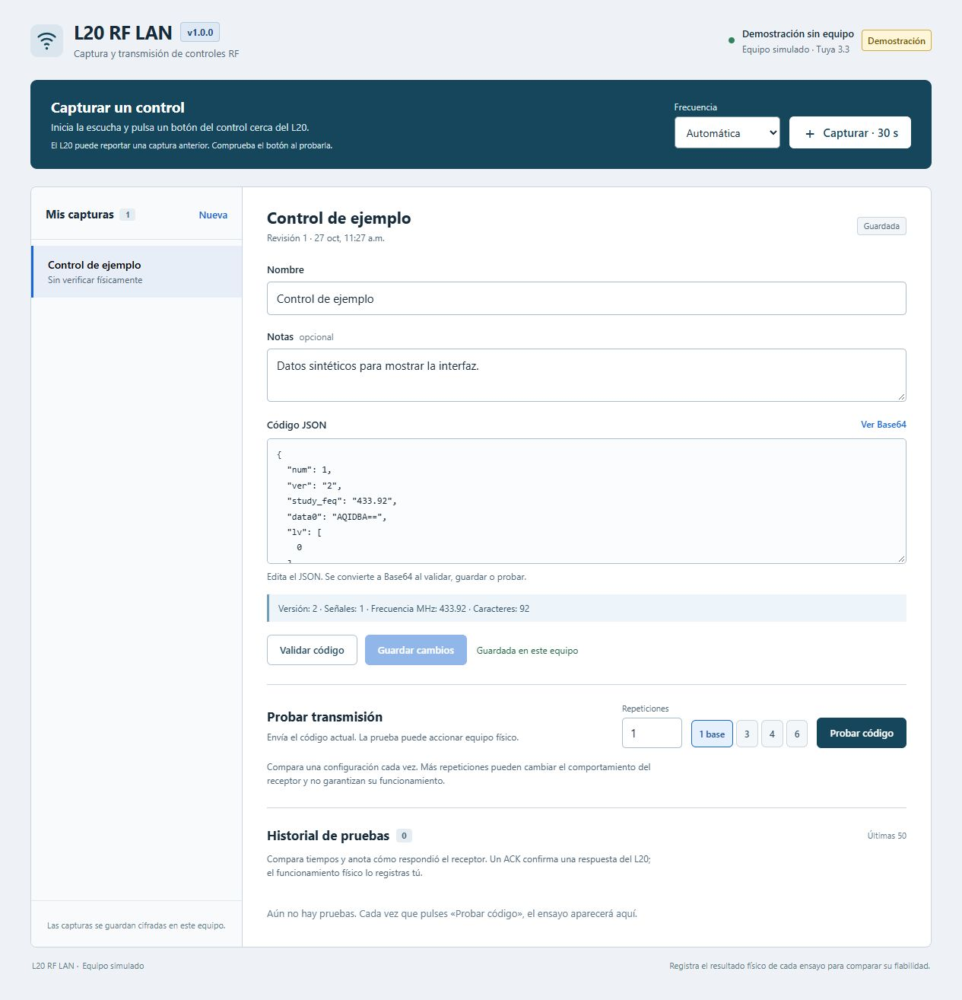
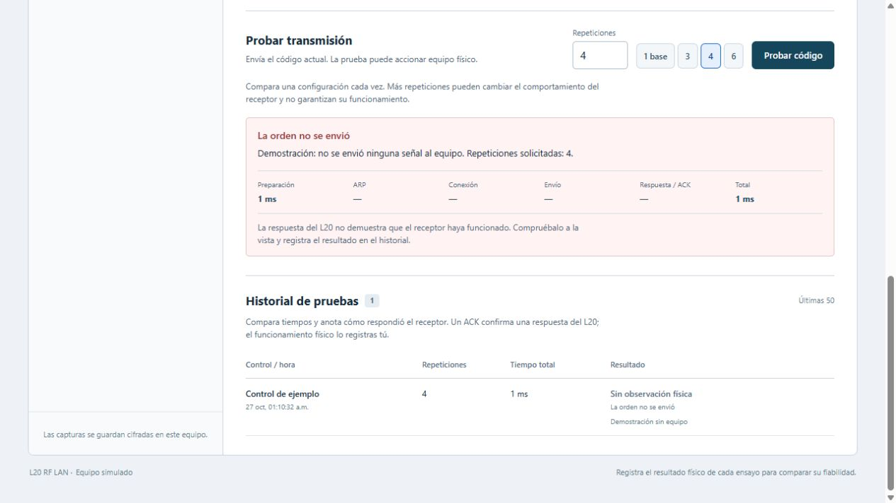

# L20 RF LAN para Windows

Captura, guarda, edita y transmite códigos de controles de radiofrecuencia mediante un L20 compatible con Tuya LAN 3.3. Incluye una interfaz web local y una consola. Las credenciales y las capturas se guardan cifradas con Windows DPAPI.

El proyecto trabaja con la variante de órdenes RF en DP201 y reportes en DP202, con lectura alternativa de DP2. El nombre comercial «L20» no garantiza el mismo hardware, firmware ni protocolo. Consulta [compatibilidad y protocolo](docs/PROTOCOLO.md).

## Capturas

Las imágenes muestran el modo demostración con datos sintéticos, sin credenciales ni capturas de controles personales.

**Biblioteca y editor.** Selección de una captura guardada y consulta de su contenedor JSON.



**Prueba e historial.** Ejemplo con cuatro repeticiones solicitadas. La demostración registra que no se envió ninguna señal al equipo.



## Requisitos

- Windows con Python 3.10 o superior y acceso a Internet para instalar dependencias.
- Un L20 ya configurado en su aplicación y compatible con el protocolo indicado.
- PC y L20 en la misma subred local, sin aislamiento entre clientes. La PC puede usar Ethernet o Wi-Fi. La banda admitida por el L20 depende de su hardware; comprueba si requiere Wi-Fi de 2.4 GHz.
- IPv4 privada, MAC, `device_id` y `local_key` de tu propio equipo. El proyecto no obtiene las credenciales de Tuya por sí mismo.

## Inicio rápido

Abre PowerShell dentro de esta carpeta y ejecuta:

```powershell
.\Instalar.ps1
.\.venv\Scripts\python.exe .\l20.py configure
.\Iniciar.cmd
```

`configure` solicita IP y MAC, y después `device_id` y `local_key` con entrada oculta. No incluyas secretos en los argumentos. Guarda la configuración en `.private/l20.dpapi`. Si todavía no tienes las claves, sigue [la preparación y obtención de credenciales](docs/USO.md#preparar-el-equipo-y-las-credenciales).

La web se abre en [http://127.0.0.1:58745](http://127.0.0.1:58745). Inicia una captura, pulsa un botón del control cerca del L20, asigna un nombre y guarda. Selecciona una captura para editar su nombre, notas o código, y guarda los cambios. **Probar código** transmite el contenido actual y puede accionar el equipo. Comienza con una repetición y comprueba físicamente el resultado.

Para revisar la interfaz con datos sintéticos y sin contactar con el L20:

```powershell
.\.venv\Scripts\python.exe .\l20.py web --demo
```

El archivo `examples/rf-sintetico.json` sirve para validar el formato y practicar la edición. Contiene datos de prueba, no una captura utilizable de un control.

Para usar la consola, cierra antes el servidor web. Ejecuta una sola instancia a la vez:

```powershell
.\.venv\Scripts\python.exe .\l20.py info
.\.venv\Scripts\python.exe .\l20.py capture --name "Control principal" --frequency 433.92 --seconds 30
.\.venv\Scripts\python.exe .\l20.py list
```

`list` muestra el identificador de cada captura. Sustituye el texto siguiente por el identificador que quieras transmitir:

```powershell
$id = "ID_DE_LA_CAPTURA"
.\.venv\Scripts\python.exe .\l20.py send $id --times 1
```

## Qué significa el resultado

`ACKNOWLEDGED` indica que el L20 respondió a la orden. La respuesta no demuestra emisión RF ni movimiento del portón. `UNCERTAIN` indica que el resultado no pudo confirmarse; la orden puede haber llegado. No hay reintentos automáticos: observa el equipo antes de iniciar otra prueba manual.

En la instalación que motivó este proyecto se informó apertura/cierre con respuesta intermitente y, después, buen funcionamiento al pedir cuatro repeticiones por orden. Es una observación cualitativa de ese equipo, sin número de ensayos ni tasa de éxito medidos. La adaptación genérica se verifica con pruebas sintéticas; no se ha probado físicamente con todos los equipos llamados L20. El programa no identifica si tu control usa código variable. Consulta [evidencia y límites](docs/VALIDACION.md).

## Guías

- [Instalación, configuración, consola y web](docs/USO.md)
- [Protocolo, formato de códigos y compatibilidad](docs/PROTOCOLO.md)
- [Solución de problemas](docs/SOLUCION_PROBLEMAS.md)
- [Validación y alcance de la evidencia](docs/VALIDACION.md)

Las rutas predeterminadas son `.private/l20.dpapi` para la configuración y `datos/capturas/` para la biblioteca. DPAPI vincula los archivos a la cuenta y al entorno de Windows que los creó. `export` produce texto sensible sin cifrar: úsalo solo cuando necesites editar o trasladar una captura y conserva el archivo fuera del repositorio público.

La web escucha únicamente en `127.0.0.1`; el navegador habla con el servidor local y la PC se conecta al L20 por LAN. No se ofrece acceso web remoto ni autenticación para usuarios remotos.
